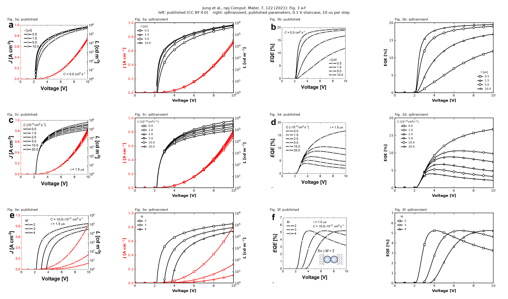

# QDLED_jvl_sim

This repository contains an independent implementation of the QD-LED model described in:

> S.-M. Jung et al., “Modelling charge transport and electro-optical characteristics of quantum dot light-emitting diodes,” *npj Computational Materials* **7**, 2021.

and used again in:

> J.-W. Jo et al., “Charge transport dynamics and emission response in quantum-dot light-emitting diodes for next-generation high-speed displays,” *Materials Today Physics* **46**, 101492, 2024.

It contains:

- [`qdtransient/`](qdtransient): a standalone, fully implicit **stepped-transient** drift-diffusion / QD rate-equation solver. It reproduces Figs. 2–5 and Supplementary Figs. 1–5 of Jung et al. from the published parameters, without additional fitting. Usage and scripts: [`qd_led_tests/transient/`](qd_led_tests/transient).
- [**Issues in the Jung 2021 and Jo 2024 QD-LED charge-transport model**](docs/jmk_model_issues.md): a write-up of what the reconstruction shows about the two papers, with every published panel shown next to its reproduction.
- `sesame/` and `qd_led_tests/`: the original reconstruction, built on the [Sesame](https://github.com/usnistgov/sesame) steady-state drift-diffusion framework. The Sesame scripts that emulate the published results are in `qd_led_tests/emulation/` on the [`replicating_JMK`](https://github.com/mikedillender/QDLED_jvl_sim/tree/replicating_JMK) branch.

## Motivation

The original publication notes that the associated code is available from the authors upon reasonable request. I was looking forward to receiving it, but unfortunately, “IP concerns” precluded its release. This repository therefore represents an independent reconstruction from the equations, parameters, and figures reported in the publication.

The reconstruction proved instructive.

## Reproduction of the published model

The model treats the organic transport layers using conventional drift-diffusion equations for doped inorganic semiconductors, while representing the quantum-dot layer as a sequence of discrete sites coupled through one-way capture, hopping, and recombination rates.

The Sesame-based reconstruction reproduces the principal published trends only with three adjustments:

- the reported HIL/HTL injection barrier is not explicitly applied;
- the built-in voltage is referenced to the electrode work functions rather than to the Fermi level implied by the stated semiconductor contact conditions; and
- a small nonradiative leakage current is included when calculating the low-current EQE.

These adjustments are discussed more fully in my master’s thesis and are represented in the `replicating_JMK` branch of this repository.

The stepped-transient solver needs only the first adjustment, which turns out to be how the original drift term was written. The other two compensate for the steady-state solution procedure. With the published parameters it gives, for example:

| | Published | `qdtransient` |
|---|---|---|
| Fig. 3 (M = 2): J(10 V), peak EQE, EQE(10 V) | 0.83 A cm⁻², 5.2 % at 4.1 V, 3.2 % | 0.81 A cm⁻², 5.24 % at 4.1 V, 3.24 % |
| Fig. 4i (αp:αn = 1.5:0.5): peak EQE, EQE(10 V) | 5.2 % at 4.0 V, 1.8 % | 5.24 % at 3.9 V, 1.80 % |
| Fig. 5, red: L(6 V), peak EQE | 25,867 cd m⁻², 10.5 % at 3.6 V | 26,068 cd m⁻², 10.46 % at 3.6 V |
| Fig. 5, blue: L(8 V), peak EQE | 1,633 cd m⁻², 1.5 % at 5.6 V | 1,710 cd m⁻², 1.56 % at 5.6 V |

*Jung et al. (2021) Fig. 3, published (left, CC BY 4.0) and reproduced by `qdtransient` (right). Every other published panel is compared in [the write-up](docs/jmk_model_issues.md).*

## Issues in the published model

Reproducing the papers this closely makes the remaining differences informative: they are differences in method, not in physics or parameters. In brief (details, figures and numbers in [the write-up](docs/jmk_model_issues.md)):

1. **The published curves are not steady states.** Jung Fig. 4g–i matches a voltage staircase of about 0.1 V every 10 µs. The paper never states a sweep rate, and the steady state puts the hole-rich EQE peak at 3.3 V rather than the published 4.0 V.
2. **Fig. 4j–l does not follow from the stated equations.** Solved as written, the carrier with the smaller band offset charges the dots first and turn-on occurs at 2.8–3.6 V. The published 4.1 V turn-on and 5.2 % EQE spike appear only if neither carrier is captured until *both* interface fields exceed their offsets, a coupling the paper never describes.
3. **Unstated modelling and discretisation choices.** The transport-layer drift ignores band offsets, the anode contact contradicts the paper's own Eq. (10), and the injection depends on the mesh: refining the 1 nm transport mesh to 0.25 nm raises the current at 10 V by 19 %.
4. **Errors in the printed equations.** Jung et al. swap the field definitions for holes and electrons; Jo et al. print an injection law with inconsistent units and omit the tunnelling probabilities it needs.
5. **Physical assumptions that shape the results.** One-way capture with no emission, an F3/2 “Poole–Frenkel” factor that acts as a hard threshold, and Boltzmann statistics at ten times the band-edge density of states.
6. **Jo et al. (2024).** Its radiative coefficient is 38 times below its own Langevin formula, its recombination constants differ from the 2021 fits for comparable devices by factors of 58–170, and its trapped-charge degradation mechanism is built into the no-emission assumption.

The papers’ qualitative messages (Auger-driven roll-off, the importance of charge balance) survive. Their quantitative thresholds, EQE shapes and fitted parameters depend on details they do not report.

## Points requiring interpretation

Several aspects of the published formulation are not stated in the paper and had to be inferred.

### HIL/HTL interface

Using the stated energy levels and conventional heterojunction boundary conditions produces substantial depletion of the HTL and a corresponding voltage drop across it. This behavior is not apparent in the published carrier-density or electrostatic profiles.

The published profiles are reproduced when the drift term in the transport layers uses only the electrostatic field, so that the band offsets between transport layers never enter. The supplementary information supports this directly. The hole density falls smoothly from 2.8 × 10¹⁹ to ~3 × 10¹⁷ cm⁻³ across the PEDOT:PSS/TFB interface, and the HTL potential sits ~0.1 V *above* the HIL. That is the diffusion potential of a p⁺/p doping step, not of a 0.43 eV heterojunction. Whether this was an intended simplification or merely an especially cooperative interface is not specified.

### Contact potentials

A self-consistent ohmic contact to the degenerately doped PEDOT:PSS gives a built-in voltage larger than that implied by the electrode work functions. The resulting turn-on voltage is correspondingly higher than the published result.

The published profiles instead fix the anode potential at V − 0.64 V (the ITO/Al work-function difference) and the anode hole density at the PEDOT:PSS doping level, not at the value the paper’s Eq. (10) gives. This is physically plausible for a highly conductive PEDOT:PSS contact, although it is not the result obtained from a literal application of the reported semiconductor parameters. In Sesame, the reference therefore has to be corrected after the fact. In a solver whose unknowns are the potential and the carrier densities, it is simply a pair of Dirichlet boundary conditions.

### EQE turn-on and the solution procedure

The steady-state Newton solver predicts an abrupt increase in EQE at turn-on. The cause is not a missing leakage path. Below threshold, capture is one-way and there is no emission, so nothing in the model determines how full the quantum dots are; only the voltage history does. A direct steady-state solve is singular there. The Sesame build stays solvable only because a strongly attenuated drift-diffusion link (`/1e10`) remains between the dots and the transport layers. Given infinite time, that link fills the dots with holes from the flooded HTL before any carrier can be captured. The first captured electrons then meet a full hole reservoir, and the EQE jumps immediately to its radiative limit.

Solving the same equations as a voltage staircase in time, starting from empty dots, reproduces the published gradual rise without any leakage current.

### Transport and injection assumptions

The capture coefficient contains a field-dependent factor proportional to \(F^{3/2}\), described as a polynomial approximation to Poole–Frenkel enhancement of the mobility. In practice, because the relevant field includes the band offset and the expression is not defined for negative fields, this term also conveniently imposes an effective injection threshold, neglecting any thermally assisted injection.

Why exactly this is described as a "Poole-Frankel" enhancement of mobility, when the actual inter-dot hopping rate and transport-layer mobilities are field-independent, remains unclear.

More generally, the model treats the transport layers as constant-mobility, heavily doped inorganic semiconductors. This provides a tractable numerical system, although its applicability to disordered organic HTLs should be interpreted with appropriate enthusiasm.

## Limitations of this implementation

This reconstruction also has limitations of its own.

Most importantly, both implementations use Boltzmann carrier statistics. That approximation is questionable in the high-accumulation regime near the QD interfaces, where the computed densities exceed the effective density of states. The close quantitative match between the accumulation profiles generated here and those in the published work strongly suggests that the original calculation used the same approximation. Given the Einstein relation in the paper and the explicitly Boltzmann boundary conditions at the contacts, this problem does not appear to be uniquely mine.

The implementation should therefore be understood as a reconstruction of the reported model, not as a definitive physical description of QD-LED operation.

It is provided publicly so that the assumptions can be inspected, modified, and tested without requiring any further reasonable requests.

## Further discussion

The issues with the published model are set out in [docs/jmk_model_issues.md](docs/jmk_model_issues.md). The Sesame-based implementation and its interpretive choices are described in Chapter 4 and Appendix B of:

> M. Dillender, *Light and Charge Dynamics in Quantum Dot LEDs*, MIT master’s thesis, 2026.
