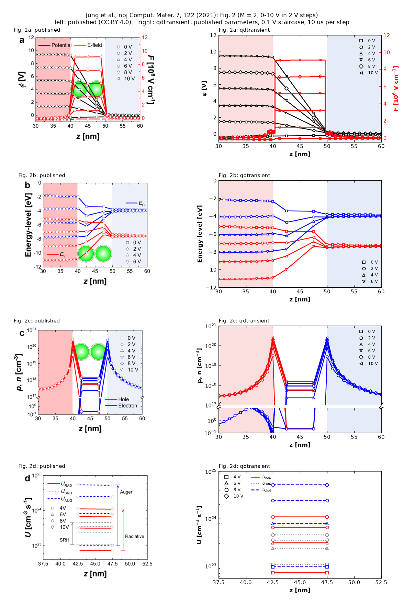
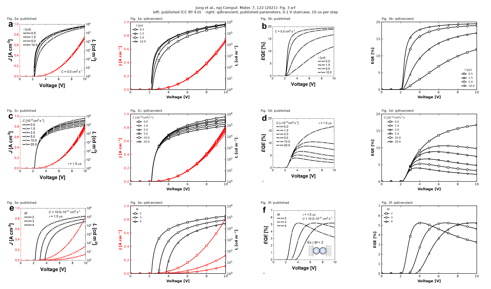
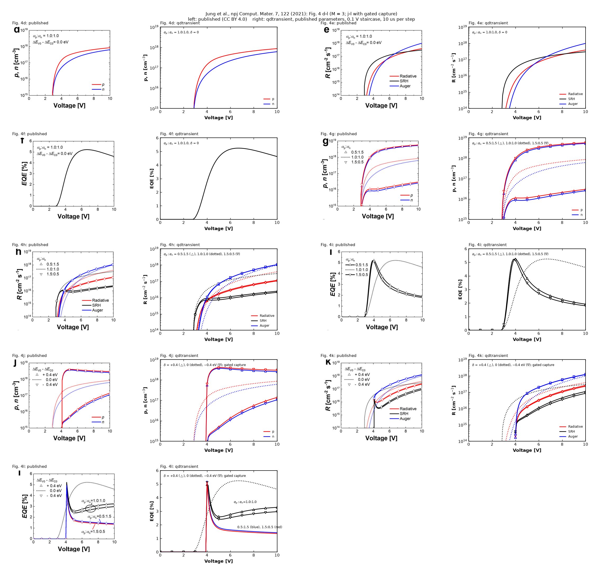
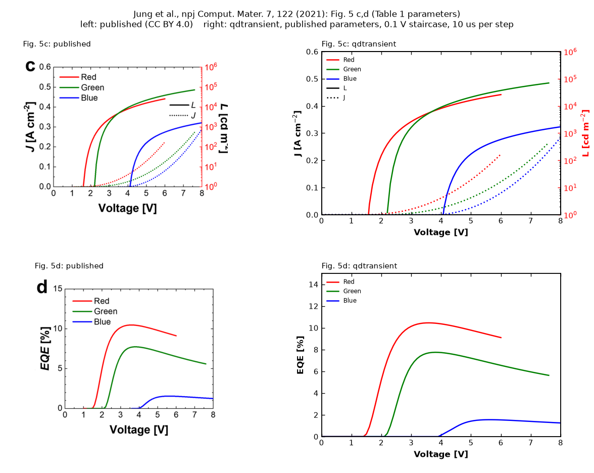
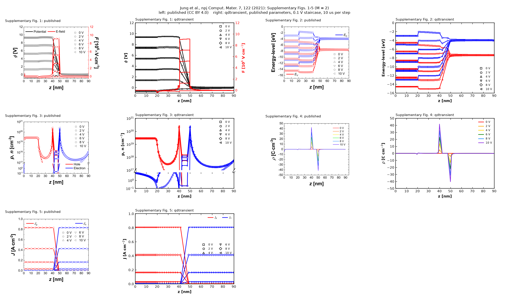
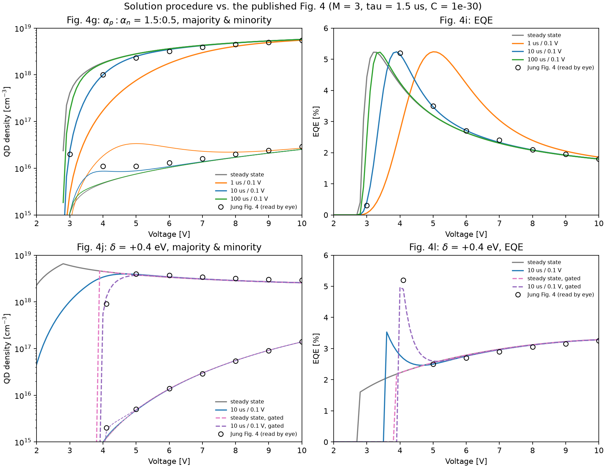
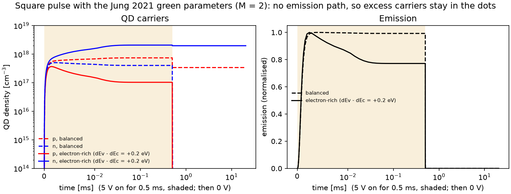

# Issues in the Jung 2021 and Jo 2024 QD-LED charge-transport model

M. Dillender · 21 November 2026

## Summary

Jung et al. (2021) can be reproduced figure for figure from its published parameters, but only by adopting modelling and numerical choices the paper does not state. One of its figures (Fig. 4j–l) cannot be produced by its own equations at all. Jo et al. (2024) reuses the same model, prints its injection law in a form that is not dimensionally consistent, and draws a degradation conclusion that follows directly from the model's no-emission assumption.

The evidence comes from an independent stepped-transient solver ([`qdtransient`](../qdtransient)), run with the papers' parameters and nothing fitted. Its results are shown next to every published panel of Jung Figs. 2–5 and Supplementary Figs. 1–5 below.

| # | Issue | Paper | Consequence | Basis |
| --- | --- | --- | --- | --- |
| 1 | Published curves are snapshots of an unstated voltage ramp (≈ 0.1 V per 10 µs), not steady states | Jung 2021 | Hole-rich EQE peak at 4.0 V instead of the steady-state 3.3 V | Reproduced |
| 2 | Fig. 4j–l needs capture to be blocked until *both* interface fields exceed their offsets | Jung 2021 | Self-consistent turn-on is 2.8–3.6 V, not 4.1 V; EQE spike ≤ 3.5 %, not 5.2 % | Reproduced |
| 3 | Unstated choices: no band offsets in transport-layer drift, contacts that contradict Eq. 10, a 1 nm mesh with box-method volumes, mesh-dependent injection | Both | Required to obtain the published currents, profiles and EQE | Reproduced |
| 4 | Errors in printed equations (swapped field definitions, injection law without consistent units, missing constants) | Both | Literal use of the equations gives wrong or dimensionally invalid results | Read from the papers |
| 5 | Physical assumptions: one-way capture with no emission, an F^1.5 "Poole–Frenkel" factor that acts as a hard threshold, Boltzmann statistics at densities above N_V | Both | QD occupation below threshold is set by history, not physics | Reproduced and read |
| 6 | Jo 2024 recombination constants contradict its own Langevin formula and the 2021 fits; its trapped-charge degradation mechanism is built into the no-emission assumption | Jo 2024 | The fitted constants and the degradation conclusion are not independent results | Read and illustrated |

None of this changes the papers' qualitative messages (Auger-driven roll-off, the importance of charge balance). It does mean that their quantitative thresholds, EQE shapes and parameter fits depend on undisclosed implementation details.

## Background

Both papers come from Jong Min Kim's group at Cambridge and use the same QD-LED charge-transport model. Neither released its code; it is "available upon reasonable request", and a request for it was declined on intellectual-property grounds.

- **Jung et al. (2021)** introduces the model and fits steady current–luminance–EQE curves for red, green and blue CdSe-based devices (Figs. 2–5, Supplementary Figs. 1–5).
- **Jo et al. (2024)** applies the same model to transient electroluminescence under 6 V square pulses, and uses it to explain an emission drop during the pulse and a proposed degradation mechanism.

The model has three parts:

1. **Transport layers** (PEDOT:PSS, TFB, ZnO): constant-mobility drift–diffusion for doped semiconductors, with Boltzmann statistics and the Einstein relation.
2. **Emissive layer**: one node per QD monolayer. Carriers enter the first and last dots only by field-dependent capture (Jung Eq. 1), move between dots by tunnelling (Eq. 5), and leave only by recombination.
3. **Recombination** in the dots: SRH, Langevin radiative and Auger. EQE is the light-extraction efficiency (20 %) times the radiative fraction of all recombination.

The capture current, as printed in Jung et al., is

```math
J_p^I = q\, r_{QD}\, \pi r_{QD}^2\, \alpha_p\, \frac{F_p^{3/2}}{F_0^{1/2}}\, p_H \left(N_{QD} - p_{Q1}\right), \qquad F_p = -\frac{\partial \phi}{\partial z} - \frac{\Delta E_{V0}}{q\, r_{QD}} \geq 0
```

with a mirror-image expression for electrons. Here p_H is the hole density at the HTL surface, N_QD the dot density and α_p a fitted "charge-injection mobility".

The reconstruction used here, `qdtransient`, solves Poisson's equation and both continuity equations for the potential and the logarithms of n and p on a finite-volume mesh. It uses Scharfetter–Gummel fluxes in the transport layers and backward-Euler time stepping, and applies the bias as a voltage staircase. An earlier steady-state reconstruction in Sesame (thesis, Ch. 4 and App. B) matched the papers only with three workarounds: no HIL/HTL barrier, a 0.88 V built-in-voltage shift and an artificial leakage current. The new solver needs only the first, which turns out to be how the original transport equations were written.

## Reproduction status

With the published parameters, nothing fitted, and the choices described under Issues 1–3, `qdtransient` reproduces every panel of Jung Figs. 2–5 and Supplementary Figs. 1–5 to within the precision of reading the plots. That agreement is what makes the remaining discrepancies informative: they are differences in method, not in physics or parameters.

| Quantity | Published | qdtransient |
| --- | --- | --- |
| Fig. 2d rates at 4 V: radiative, SRH, Auger (cm⁻³ s⁻¹) | 7.4e22, 1.1e23, 9.9e22 | 7.2e22, 1.08e23, 9.6e22 |
| Fig. 3, M = 2: J(10 V), L(10 V) | 0.83 A cm⁻², 127,226 cd m⁻² | 0.81 A cm⁻², 122,400 cd m⁻² |
| Fig. 3, M = 2: peak EQE, EQE(10 V) | 5.2 % at 4.1 V, 3.2 % | 5.24 % at 4.1 V, 3.24 % |
| Fig. 4f, balanced (M = 3): peak EQE | 5.2 % at 6.7 V | 5.24 % at 6.7 V |
| Fig. 4i, hole-rich: peak EQE, EQE(10 V) | 5.2 % at 4.0 V, 1.8 % | 5.24 % at 3.9 V, 1.80 % |
| Fig. 5, red: L(6 V), peak EQE, EQE(6 V) | 25,867 cd m⁻², 10.5 % at 3.6 V, 9.1 % | 26,068 cd m⁻², 10.46 % at 3.6 V, 9.10 % |
| Fig. 5, green: L(7.6 V), peak EQE, EQE(7.6 V) | 72,905 cd m⁻², 7.7 % at 3.8 V, 5.6 % | 69,703 cd m⁻², 7.75 % at 3.8 V, 5.63 % |
| Fig. 5, blue: L(8 V), peak EQE, EQE(8 V) | 1,633 cd m⁻², 1.5 % at 5.6 V, 1.2 % | 1,710 cd m⁻², 1.56 % at 5.6 V, 1.26 % |
| SI Fig. 4: peak charge density at the HTL/ETL interfaces, 10 V (C cm⁻³) | +42, −41 | +42, −40 |

Published values are quoted from the text where it gives them and otherwise read off the figures. Luminance assumes a 30 nm emission linewidth, which the paper does not state.

Figures A–E place each published panel (left) next to the same quantity from `qdtransient` (right), drawn with the paper's axis ranges, colours and symbols. Panels are reproduced from Jung et al. (2021) under [CC BY 4.0](https://creativecommons.org/licenses/by/4.0/).



*Figure A. Jung Fig. 2a–d (M = 2): potential and field, band edges, carrier densities and recombination rates at 0–10 V.*



*Figure B. Jung Fig. 3a–f: J–L and EQE versus voltage for the SRH-lifetime, Auger and QD-layer sweeps.*



*Figure C. Jung Fig. 4d–l (M = 3): QD densities, recombination rates and EQE for balanced and imbalanced injection. Panels j–l use gated capture (Issue 2).*



*Figure D. Jung Fig. 5c,d: red, green and blue devices with the Table 1 parameters.*



*Figure E. Jung Supplementary Figs. 1–5: whole-device potential, bands, densities, charge and current at 0–10 V.*

## Issue 1: the published curves are not steady states

Jung Fig. 4g–i matches a voltage staircase of about 0.1 V every 10 µs (≈ 10⁴ V s⁻¹), not the steady state, and the paper never states a ramp rate or dwell time. It describes the method only as solving the continuity and Poisson equations for "the dynamic motion of charge carriers", and calls the Fig. 2 profiles "steady-state".

The procedure matters because capture is one-way. When one carrier is injected faster, its excess piles up in the dots until its own space charge equalises the two capture currents. Near turn-on that takes tens of microseconds, so the result depends on how long each voltage is held.

| Procedure | Hole-rich (α_p:α_n = 1.5:0.5) EQE peak | Majority density at 3 V / 4 V (cm⁻³) |
| --- | --- | --- |
| Published (Fig. 4g, i) | 5.2 % at 4.0 V | 2e16 / 1e18 |
| Steady state at each voltage | 5.2 % at 3.3 V | 4.1e17 / 1.8e18 |
| Staircase, 100 µs per 0.1 V | 5.2 % at 3.4 V | 1.7e17 / 1.8e18 |
| **Staircase, 10 µs per 0.1 V** | **5.24 % at 3.9 V** | **2.3e16 / 1.0e18** |
| Staircase, 1 µs per 0.1 V | 5.2 % at 5.0 V | 2.9e15 / 1.7e17 |

Only the 10 µs staircase reproduces the published densities at every voltage, including the minority-carrier plateau between 4 and 5 V. For balanced injection (Fig. 4d–f) the procedure changes only the first volt above turn-on; the EQE peak sits at 6.7 V in every case.

So the EQE-peak voltage in Fig. 4i, which the paper reads as a property of the charge imbalance, also depends on an unreported sweep rate. A steady-state solver, which is how such models are normally run, cannot reproduce the figure.



*Figure F. Majority and minority densities and EQE for the hole-rich (top) and δ = +0.4 eV (bottom) cases of Jung Fig. 4, for different solution procedures. Circles are values read from the published figure.*

## Issue 2: Fig. 4j–l does not follow from the stated equations

Fig. 4j–l (band-offset imbalance, ΔE_V0 − ΔE_C0 = ±0.4 eV) is reproduced only if neither carrier can be captured until *both* interface fields exceed their offsets. Nothing in the paper describes such a coupling, and solved as written the equations give a different threshold and a different EQE curve.

Take the electron-rich case, ΔE_V0 = 0.54 eV and ΔE_C0 = 0.14 eV (M = 3). As written, Eq. 1 starts capturing electrons once the field exceeds ΔE_C0/(q r_QD) = 0.56 MV cm⁻¹, at about 1.6 V. With no holes to recombine with, the electrons charge the dots until they screen their own interface field. That charge raises the field at the HTL side, so hole capture starts at about 2.8 V (steady state) or 3.6 V (10 µs staircase).

The paper instead shows empty dots until 4.1 V. That is the threshold of its Eq. 2, V_th ≈ (2M/q)·max(ΔE_C0, ΔE_V0) + V_bi, which the paper derives "with the approximation of linear distribution of a potential field", i.e. ignoring this space charge.

| δ = +0.4 eV | Turn-on | EQE spike | Majority at 5 V (cm⁻³) | EQE at 5 V / 10 V |
| --- | --- | --- | --- | --- |
| Published (Fig. 4j, l) | 4.1 V | 5.2 % | 4e18 | 2.5 % / 3.25 % |
| As written, steady state | 2.8 V | none | 3.8e18 | 2.55 % / 3.3 % |
| As written, 10 µs staircase | 3.6 V | 3.5 % | 3.8e18 | 2.5 % / 3.3 % |
| Gated capture, 10 µs staircase | 4.0 V | 5.0 % | 3.7e18 | 2.6 % / 3.3 % |

Above about 5 V all versions agree, because by then the dots have reached the same space-charge balance. The gated version also reproduces the SRH dip in Fig. 4k and the 1.4 % curves for the doubly imbalanced cases in Fig. 4l (Figure C, panels j–l).

The gate has no physical basis: electron capture at the ETL interface cannot depend on the field at the HTL interface. The original code may have implemented something equivalent rather than this exact rule, but it must contain some such coupling. Two of the paper's conclusions rest on it: that the threshold is set by the *larger* band offset, and the sharp EQE spike used to explain "type III" EQE curves.

## Issue 3: results depend on unstated modelling and discretisation choices

Four choices that the papers do not state are needed to reproduce Jung's figures. Each can be inferred from the published profiles, and each changes the results substantially if made differently.

| Choice | Evidence in Jung 2021 | If made differently |
| --- | --- | --- |
| Transport-layer drift uses the electrostatic field only, so band offsets between transport layers never enter | SI Fig. 3: holes fall smoothly from 2.8e19 to ~3e17 cm⁻³ across the PEDOT:PSS/TFB interface. SI Fig. 1: the HTL sits ~0.1 V *above* the HIL, the p⁺/p diffusion potential kT·ln(2.8e19/3e17) ≈ 0.12 V | A 0.43 eV heterojunction depletes the HTL to ~1e12 cm⁻³ at the interface; current falls ~20× and turn-on rises |
| Anode fixed at φ = V − 0.64 V with the hole density at the PEDOT:PSS doping level | SI Fig. 3 shows p ≈ 2–3e19 cm⁻³ at the anode, whereas Eq. 10 with the ITO work function gives 3e11 cm⁻³. The electron density there (~8 cm⁻³) does follow Eq. 10 | A self-consistent ohmic contact gives V_bi ≈ 1.5 V and a turn-on ~0.9 V higher |
| Box-method control volumes on a 1 nm transport mesh with a node at each QD centre: 3.75 nm per outer dot, 1.75 nm for the HTL/ETL surface nodes | Only these volumes make the Fig. 2d rates reproduce J(10 V) = 0.83 A cm⁻² and L(10 V) = 127,226 cd m⁻², and give the SI Fig. 4 peak of 42 C cm⁻³ | Other volumes change the current per unit recombination rate and the interface densities |
| The capture current uses the density of the HTL/ETL surface *cell* | Implied by the mesh above | See the mesh-refinement table below |

The last point means the model is not mesh-converged. The accumulated holes at the HTL surface sit in a layer about 0.2 nm thick (the Debye length at 2e20 cm⁻³), much thinner than the 1 nm cell. Capture is proportional to that cell's average density, so refining the mesh raises the injection:

| Transport-layer mesh | p_H at 10 V (cm⁻³) | J(10 V) (A cm⁻²) | L(10 V) (cd m⁻²) | EQE peak |
| --- | --- | --- | --- | --- |
| 1 nm (as published) | 2.6e20 | 0.81 | 122,400 | 5.24 % at 4.1 V |
| 0.5 nm | 3.0e20 | 0.91 | 133,400 | 5.24 % at 3.9 V |
| 0.25 nm | 3.2e20 | 0.97 | 138,700 | 5.24 % at 3.8 V |

The fitted injection mobilities (α in Table 1 and Supplementary Table 1) therefore only mean something together with the original mesh. The Sesame reconstruction placed its interface node 0.25 nm from the dots with a clipped 0.375 nm box, and needed α scaled down by a factor of 0.3–0.4 to match.

## Issue 4: errors in the printed equations

Several printed expressions cannot be what the codes computed. The published results show the intended forms were used, so these are errors of presentation, but a reader implementing the equations as printed gets wrong or dimensionally invalid results.

| Paper | Where | As printed | Problem |
| --- | --- | --- | --- |
| Jung 2021 | Methods, after Eq. 5 | F_p = (1/q)∂E_C/∂z and F_n = (1/q)∂E_V/∂z | Swapped: the hole field is taken from the conduction band and the electron field from the valence band. Taken literally, hole capture would be governed by the 1.06 eV conduction-band step at the HTL/QD interface instead of ΔE_V0 = 0.34 eV |
| Jung 2021 | Eq. 10 | Contact densities from the electrode work function | Correct as printed, but the published profiles do not use it for holes at the anode (Issue 3) |
| Jo 2024 | Eq. 2 | J_p^I = q r_QD S_p σ T_p μ_p E_p^3/2 p_H (N_QD − p_QD) | Not dimensionally consistent: without Jung's F_0^−1/2 the result has units of C cm⁻²·⁵ V⁰·⁵ s⁻¹, not A cm⁻². Table S1 still quotes the QD mobility "@ F_0 = 5 MV cm⁻¹", so the normalisation appears to have been dropped from the printed equation |
| Jo 2024 | Eq. 2 and Tables S1–S2 | Tunnelling probabilities T_p, T_n | No values are given, nor the shell effective masses needed to compute them from Jung's SI Eq. 1. The injection strength cannot be reproduced from the paper |
| Jo 2024 | Eq. 2 (electrons) | S_QD | Should be S_n |
| Jo 2024 | Table S1 | QD-core conduction band edge 3.63 eV | Sign missing; −3.63 eV is implied by the shell value of −3.35 eV |

Jo et al. also describe the transport-layer currents as "ballistic drift-diffusion". Drift–diffusion transport is by definition not ballistic, and the equations they give are ordinary drift–diffusion.

## Issue 5: physical assumptions that shape the results

Three assumptions do more than simplify: they produce the threshold behaviour, the history dependence and the sensitivity to discretisation described above.

**One-way capture with no emission.** Carriers can enter a dot but never return to a transport layer; Jo et al. state that decay is "determined solely by the carrier recombination process, neglecting the carrier leakages". Below threshold nothing then determines the QD occupation: it is whatever the voltage history left there. The earlier model this one extends (Kumar et al., 2013) balanced capture against emission by detailed balance; Jung et al. drop the emission term.

The consequences can be seen directly:

- A steady-state Newton solve is singular below threshold. The Sesame reconstruction converged only through a residual drift–diffusion link between dots and transport layers, scaled down by 1e10; with the factor raised to 1e20 it fails at 0.1 V.
- With that residual link, the infinite-time solution fills the dots with holes before any capture: p_QD = 1.9e18 cm⁻³ at 2.9 V while J = 2e-10 A cm⁻². The first captured electrons then give an immediate 18 % EQE instead of the published gradual rise.
- The same assumption causes the sweep-rate dependence (Issue 1), allows the hidden coupling of Issue 2 to matter, and creates the trapped charge in Jo 2024 (Issue 6).

**An F^3/2 "Poole–Frenkel" factor that acts as a hard threshold.** The capture coefficient scales as F^3/2/F_0^1/2, described as a polynomial approximation to Poole–Frenkel enhancement of the QD mobility. Poole–Frenkel enhancement goes as exp(β√F), and neither the inter-dot hopping nor the transport-layer mobilities are field-dependent. Because F already subtracts ΔE/(q r_QD) and is clipped at zero, the factor's real role is a sharp injection threshold with no thermally assisted injection below it. Measured devices turn on gradually, with clear thermal activation (thesis, Ch. 3).

**Boltzmann statistics far above the band-edge density of states.** The hole density at the HTL surface reaches 2.6e20 cm⁻³ at 10 V, ten times the TFB effective density of states (2.5e19 cm⁻³, m* = 1). At these densities carriers are degenerate: Boltzmann statistics overestimate the density for a given Fermi level, and the Einstein relation used for diffusion no longer holds. Capture is proportional to exactly this density. The organic HTL is also modelled as a constant-mobility doped inorganic semiconductor rather than a disordered Gaussian-DOS material.

## Issue 6: Jo et al. (2024) — recombination constants and the trapped-charge conclusion

Jo et al. fit recombination constants that contradict both their own Langevin formula and the 2021 fits for comparable devices. Their proposed degradation mechanism, charge left in the dots after switch-off, is a built-in property of the no-emission model rather than a finding.

**The "Langevin" coefficient is a free parameter.** The group's Langevin formula, γ = q(μ_p + μ_n)/(ε_r ε_0), gives 0.58e-12 cm³ s⁻¹ for the 2021 mobilities, exactly the value Jung et al. use. With the 2024 values (μ_p = μ_n = 1e-6 cm² V⁻¹ s⁻¹, ε_r = 9.4) the same formula gives 3.9e-13. Jo et al. instead use B = 1e-14, 38 times smaller, chosen to fit the measured switch-off response.

**The two papers' constants describe incompatible devices.** Both study green CdSe/ZnS QD-LEDs (545 and 530 nm) on the same PEDOT:PSS/TFB/ZnO stack, with similar peak EQEs (7.7 % and 8.0 %).

| Constant | Jung 2021 (green, Table 1) | Jo 2024 (Table S1) | Ratio |
| --- | --- | --- | --- |
| SRH rate A = 1/(τ_p + τ_n) | 1.7e5 s⁻¹ | 1e3 s⁻¹ | 170× |
| Radiative B | 5.8e-13 cm³ s⁻¹ | 1e-14 cm³ s⁻¹ | 58× |
| Auger C = C_p + C_n | 1.3e-30 cm⁶ s⁻¹ | 1e-32 cm⁶ s⁻¹ | 126× |

With the 2021 constants and dot densities of ~5e17 cm⁻³, the carriers would decay in about 1 µs after switch-off, not the measured ~0.3 ms. Neither paper notes that one set of constants is incompatible with the other set's data.

**Trapped charge after switch-off is assumed, not predicted.** Jo et al. show excess electrons (7e17 cm⁻³) left in charge-imbalanced dots after the pulse, and propose that the resulting fields drive oxidation and degradation. In this model, once the minority carrier has recombined, the excess majority has no exit: no emission, no recombination partner. It therefore stays indefinitely, whatever the device. Figure G shows this with the 2021 green parameters: with ΔE_V0 − ΔE_C0 = +0.2 eV, 2.0e18 cm⁻³ of electrons remain 20 ms after switch-off. Even the nominally balanced device keeps 3.4e17 cm⁻³ of holes, because its HTL injects slightly more than its ETL.

Whether real dots keep this charge depends on emission back to the transport layers under the built-in field, which the model sets to zero. The emission drop during the pulse, Jo et al.'s main experimental observation, is reproduced (about 23 % for +0.2 eV), so that part of the analysis does not depend on this objection.



*Figure G. QD carrier densities and normalised emission for a 0.5 ms, 5 V pulse followed by 0 V, with the Jung 2021 green parameters (M = 2). Dashed: balanced offsets. Solid: ΔE_V0 − ΔE_C0 = +0.2 eV. Excess carriers remain in the dots after switch-off.*

## What remains valid

The qualitative conclusions survive; the quantitative ones should not be used without the missing details.

| Conclusion | Status |
| --- | --- |
| Auger recombination drives EQE roll-off; SRH limits the low-current EQE (Jung Fig. 3) | Holds under any solution procedure |
| Charge imbalance moves the EQE peak and steepens roll-off (Jung Fig. 4g–i) | Holds qualitatively; the peak voltage depends on an unreported sweep rate |
| Turn-on is set by the larger band offset, V_th ≈ (2M/q)·max(ΔE_C0, ΔE_V0) + V_bi (Eq. 2, Fig. 4j–l) | Not supported by the stated equations; needs the hidden coupling of Issue 2 |
| Fitted injection mobilities α (Table 1) | Tied to an unconverged 1 nm mesh |
| Fitted recombination constants (Jung Table 1, Jo Table S1) | Mutually inconsistent across the two papers |
| Emission drop during a pulse comes from charge imbalance plus Auger (Jo Fig. 5) | Reproduced |
| Trapped charge after switch-off as a degradation mechanism (Jo Fig. 6) | Follows from the no-emission assumption |

Anyone building on this model should report the sweep procedure, include emission back to the transport layers, check mesh convergence at the QD interfaces, and treat the interface densities with Fermi–Dirac or Gaussian-disorder statistics. Releasing the original code would resolve most of the questions raised here.

## Reproducing this analysis

Everything here is generated by [`qdtransient`](../qdtransient) (Python, needing only numpy, scipy and matplotlib) and the scripts in [`qd_led_tests/transient/`](../qd_led_tests/transient). The full set of 54 sweeps takes about 3 minutes on 20 cores.

| Script | Produces |
| --- | --- |
| `jung2021_runs.py` | Every configuration in Jung Figs. 2–5, as a 10 µs staircase and as steady states |
| `side_by_side.py` | Figures A–E (needs the two PDFs and pymupdf) |
| `procedure_comparison.py` | Figure F and the Issue 1 and 2 tables |
| `paper_checks.py` | The mesh-refinement table (Issue 3) and Figure G |

The options `gate_injection=True` (Issue 2) and `sesame_leak=1e-10` (Issue 5) are diagnostics that reproduce the behaviours discussed; neither is part of the physical model. The Sesame runs quoted in Issue 5 use `qd_led_tests/emulation/recreate_fig3.py` on the [`replicating_JMK`](https://github.com/mikedillender/QDLED_jvl_sim/tree/replicating_JMK) branch.

## References

1. S.-M. Jung, T. H. Lee, S. Y. Bang, … J. M. Kim, "Modelling charge transport and electro-optical characteristics of quantum dot light-emitting diodes", *npj Computational Materials* 7, 122 (2021), [doi:10.1038/s41524-021-00591-9](https://doi.org/10.1038/s41524-021-00591-9), and its Supplementary Information. CC BY 4.0.
2. J.-W. Jo, Y. Kim, B. Hou, S.-M. Jung, J. M. Kim, "Charge transport dynamics and emission response in quantum-dot light-emitting diodes for next-generation high-speed displays", *Materials Today Physics* 46, 101492 (2024), [doi:10.1016/j.mtphys.2024.101492](https://doi.org/10.1016/j.mtphys.2024.101492), and its Supplementary Data. CC BY 4.0.
3. B. Kumar, S. A. Campbell, P. P. Ruden, "Modeling charge transport in quantum dot light emitting devices with NiO and ZnO transport layers and Si quantum dots", *Journal of Applied Physics* 114 (2013).
4. M. Dillender, *Light and Charge Dynamics in Quantum Dot LEDs*, MIT master's thesis (2026), Ch. 3–4 and App. B.
